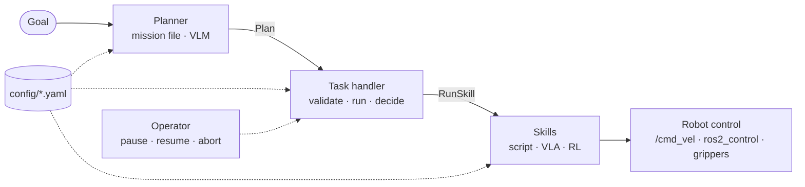
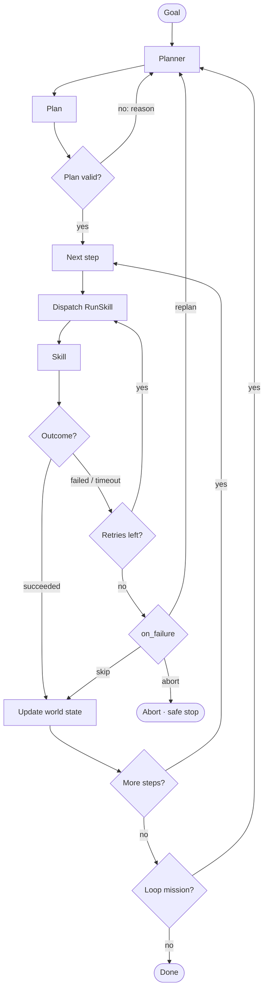

# taskweave

Config-driven task planning and execution for ROS 2 robots.

A **planner** turns a goal into steps, a **task handler** runs them and decides what happens when one fails, and
**skills** do the work behind a single ROS 2 action. Every location, grasp point, speed and decision rule comes from
YAML. Robot hardware is described in one profile, so the same mission runs on a different robot.

Skills can be scripts today and learned policies (VLA, RL) tomorrow; the planner can be a mission file today and a
VLM tomorrow. Neither change touches the rest of the system.

## How it fits together



| Layer | Responsibility | Never does |
|---|---|---|
| Planner | Goal → plan (ordered steps, each with `instruction`, `skill`, `args`) | Call controllers |
| Task handler | Validate the plan, run steps, apply retry / replan / skip / abort, publish status | Know how a skill works |
| Skills | Execute one step behind `RunSkill`, address robot *roles* via the robot profile | Know about plans or other steps |
| Config | Every point, number, name and rule | Contain code |

Each step carries a natural-language `instruction` as well as a structured `skill` + `args`, so the same plan works
for scripted skills and for language-conditioned policies.

## Decision flow



Every decision reads its rule from the mission file (`timeout_s`, `retries`, `on_failure`, `replan_from`,
`max_replans`, `loop`, `stop_when`).

## A mission

A mission is a YAML file in the cell pack (`missions/<name>.yaml`). This one picks the top part of the fullest stack
with both hands and puts it into a bin; it uses only generic skills and names from the cell pack:

```yaml
goal: Move parts from the fullest stack into the bin
loop: forever                       # once | forever
facts:
  next_stack: {fullest: part, among: "part_stack_*"}   # fixed for each cycle; none left = mission complete
defaults: {timeout_s: 120, retries: 1, on_failure: abort}
steps:
  - id: to_stack
    instruction: Drive to the stance at {next_stack}
    skill: navigate_to
    args: {target: "stance:{next_stack}"}      # where this robot stands at that stack (robots/<robot>/stances.yaml)
  - instruction: Open both grippers
    skill: grip
    args: {hands: all, action: open}
  - instruction: Pre-grasp 10 cm above the part
    skill: move_gripper
    args: {to: {point: "{next_stack}/grasp", offset_m: 0.1}}
    retries: 2
    on_failure: replan              # ask the planner again ...
    replan_from: to_stack           # ... starting at the drive
  - instruction: Onto the part
    skill: move_gripper
    args: {to: {point: "{next_stack}/grasp"}}
  - instruction: Close both grippers on the part
    skill: grip
    args: {hands: all, action: close}
  - instruction: Lift it 20 cm
    skill: move_object
    args: {to: {by: [0, 0, 0.2]}}
  - instruction: Drive to the bin
    skill: navigate_to
    args: {target: "stance:bin_1/place"}
  - instruction: Part onto the seat of the bin
    skill: move_object
    args: {to: {onto: bin_1/seat, contact: base}}
  - instruction: Let go
    skill: grip
    args: {hands: all, action: open}
```

`{next_stack}` is a **fact**, worked out when each cycle is planned (here the stack with most parts left); other
`{placeholders}` come from the world state or from the parameters of an included mission. `stance:...` is where this
robot stands at an object, `<instance>/<point>` a grasp point taught on a placed object, `contact` the frame where the
held part meets the bin. Nothing in the file names a robot: the same mission runs on any robot that has stances for the
parts and a bin. More in [docs/missions.md](docs/missions.md) (all keys, targets, hands, motion options, three complete
examples, common errors) and [docs/skills.md](docs/skills.md) (every skill and its arguments).

## Packs

- A **cell pack** is the config directory of one work cell: `pack.yaml`, `cell/` (layout, locations, placed objects),
  `objects/`, `missions/`, `skills/`, and per robot `robots/<model>/` with its stances, held poses and object points.
- A **robot pack** holds one robot model and nothing about a cell: `profile.yaml` (how the hardware is reached),
  `embodiment.yaml` (what it can do), poses, navigation, MoveIt files. `taskweave_robots` ships the bundled ones and
  installs them to `share/taskweave_robots/`. The bundled `galbot_s1`, `galbot_g1` and `a2d` packs are vendor-derived and
  internal use only: see each pack's `LICENSE-NOTE.md`.
- A cell file overrides the robot pack's file key by key (`~override: keys`), so one robot model serves many cells.
  Layout, search order and migration: [docs/configuration.md](docs/configuration.md).

## Repository layout

| Path | Contents |
|---|---|
| [`taskweave_interfaces/`](taskweave_interfaces) | ROS 2 interfaces: `RunSkill` action, `Plan`, `PlanStep`, `TaskStatus`, `SkillInfo`, `SpeedOverride`, `ListSkills`, `StartMission`, `SetSpeedOverride`, `DescribeRobot`, `TeachPoint` |
| [`taskweave_core/`](taskweave_core) | Config loader, schemas and migrations, planners, task handler, skill server base class, speed override, smoke test, CLI |
| [`taskweave_skills/`](taskweave_skills) | Generic, robot-agnostic skills: `wait`, `navigate_to`, `drive_straight`, `move_joints`, `move_gripper`, `move_object`, `set_posture`, `grip` |
| [`taskweave_hmi/`](taskweave_hmi) | Web HMI: live mission status and control, validated mission editor, teaching, recording |
| [`taskweave_robots/`](taskweave_robots) | Robot packs (profile, embodiment, poses, MoveIt files), one folder per model |
| [`docs/missions.md`](docs/missions.md) | Writing missions: file anatomy, targets, hands, motion options, examples, common errors |
| [`docs/skills.md`](docs/skills.md) | Skill reference (generated from the skill classes: `python3 tools/gen_skills_doc.py`) |
| [`docs/configuration.md`](docs/configuration.md) | Config tree and file formats |
| [`docs/architecture.md`](docs/architecture.md) | Layers, interfaces, decision rules, design rules |
| [`docs/pack_switchover.md`](docs/pack_switchover.md) | Moving a deployment from one config directory to cell pack + robot packs |
| [`AGENTS.md`](AGENTS.md) | Guide for developers and AI agents: build, tests, rules, how to add a skill, robot pack or cell pack |

Application-specific parts (a cell's layout, its objects and missions, cell-specific skills) live in the application's
cell pack and are passed to taskweave as a config directory.

## Status

taskweave runs a full pick-and-place cell in simulation. Working today:

- Config: cell packs and robot packs with per-key overrides, schema validation, capability vocabulary, `config
  migrate` / `migrate-skills` / `slim` / `files`, `taskweave check`.
- Mission-file planner, executive (retry / replan / skip / abort), include blocks with parameters and facts, task
  handler with plan validation before anything moves, pause / resume / abort.
- Skills: `wait`, `navigate_to` (direct and Nav2), `drive_straight`, `move_joints`, `move_gripper`, `grip`,
  `move_object`, `set_posture`, with IK, MoveIt planning, elbow control and hold tracking.
- Global speed override with test mode; the smoke test against a reference run.
- Teaching (locations, stances, object points, from the CLI, the pad or the HMI); web HMI with live status, mission
  editor with validation, record tab; `describe_robot` for planners.

Planned: automatic arm selection (the planner or IK picks the arm and the torso height instead of the mission naming
them), an HMI config editor, a VLM planner and learned skills (VLA, RL) behind the same `RunSkill` interface. The
interfaces and config schemas may still change between minor versions; schema changes come with a migration.

## Usage

```bash
ros2 launch taskweave_core taskweave.launch.py config_dir:=/path/to/cell robot:=<robot> \
    skills:=wait,navigate_to,drive_straight,move_joints,grip,move_gripper,move_object,set_posture
ros2 run taskweave_hmi hmi_server --ros-args -p config_dir:=/path/to/cell -p robot:=<robot> -p host:=<address>
```

The HMI (default port 8090) has no login: bind it to a trusted network only (for example a Tailscale address).
`taskweave` below is `ros2 run taskweave_core taskweave`.

```bash
taskweave check /path/to/cell            # validate all config files offline (no ROS graph needed)
taskweave describe                       # robot card + skills of the running system
taskweave describe /path/to/cell <robot> # the same offline
taskweave skills                         # the skill catalog of the running system
taskweave run restock                    # start a mission
taskweave status --follow
taskweave pause | resume | abort
taskweave teach location staging         # save the current base pose
taskweave teach stance part_stack_1      # save it as the stance at an object (add --instance for one instance)
taskweave teach point part_stack_1/grasp # save the tools' TCPs on an object
```

### Speed override and test mode

One global override (1 to 100 %) scales the speed of every skill and, by 1/override, the step timeouts. The task handler
owns it; skills follow the latched topic `/taskweave/speed_override`. Test mode lowers the override to a safe value
when a run starts, caps it while on and restores it when the run ends (only if it lowered it). Nothing is persisted: a
handler restart starts at 100 %.

```bash
ros2 service call /taskweave/task_handler/set_speed_override taskweave_interfaces/srv/SetSpeedOverride "{percent: 50}"
ros2 service call /taskweave/task_handler/set_speed_override taskweave_interfaces/srv/SetSpeedOverride \
    "{set_test_mode: true, test_mode: true, test_percent: 10}"   # test mode on; runs start at 10 %
ros2 param set /task_handler speed_override_percent 50.0              # same path as the service
```

Test mode at 10 % means arm motion at 10 % while Nav2 drives at 30 %: the Nav2 implementation of `navigate_to` floors
the override for the Nav2 phase at its param `min_override` (default 0.3, `skills/navigate_to.yaml`; MPPI cannot do the
fine final approach into a stance at 10 %). Arms, torso, grippers, `drive_straight` and the direct controller after the
handover follow the real override. The step result reports the value as `data.speed.nav2_override` (percent).

`percent: 0` leaves the value unchanged. Handler parameters `speed_test_percent` (default 10) and `speed_cap_percent`
(default 50) set the test mode values. A base driven by Nav2 needs the `speed_gate` node between the planner and the
base (`ros2 run taskweave_core speed_gate`).

### Cell pack maintenance

```bash
taskweave config migrate /path/to/cell [--robot-packs DIR] [--dry-run]  # any older layout -> the current schema (1 -> 2 -> 3)
taskweave config migrate-skills /path/to/cell [--dry-run]               # only 2 -> 3: move_to_pose, go_to_point, gripper
                                                                        # become move_joints, move_gripper, grip, ...
taskweave config slim /path/to/cell [--dry-run]                         # whole-file robot overrides -> per-key overrides
taskweave config files /path/to/cell [<robot>]                          # where each robot file comes from
taskweave check /path/to/cell                                           # validate the result
```

### Mission smoke test

`taskweave smoke` runs a mission in the simulator from a clean start and checks every step against a stored
reference run. It talks to the HMI over HTTP only (no ROS needed where it runs): the Record tab's API resets the sim,
starts the mission and stops it after `--cycles`; the step events of `/api/state` give each step's outcome, duration
(sim time) and the `max error` a skill reports. Bag and video are off unless `--bag` / `--video` is given.

```bash
taskweave smoke run restock --hmi http://<hmi>:8090 --save-reference config/tests/restock.reference.yaml
taskweave smoke run restock --hmi http://<hmi>:8090 --reference config/tests/restock.reference.yaml
taskweave smoke compare config/tests/restock.reference.yaml run.yaml   # offline, a saved run (--save-run)
```

A step passes when it runs in the reference's order with outcome `SUCCEEDED`, its duration is within `--tolerance`
(default ±10 %) plus `--slack` seconds (1.0) of the reference, and its max error is at most reference × (1 +
tolerance) + `--error-slack` (0.002). Missing steps fail, and so do steps that are not in the reference unless
`--allow-extra`. Duration tolerance is per skill: `navigate_to` gets 25 % (Nav2 drives vary more than arm moves),
overridable with `--skill-tolerance SKILL=FRACTION` or `limits: {tolerance_by_skill: {...}}` in the reference. The
command prints a table (step, instruction, ref s, now s, Δ%, error, result), writes a report (`<name>.report.yaml`
next to the reference, or `--report FILE`) and exits 0 (passed), 1 (failed) or 2 (could not run: HMI unreachable,
recording rejected). Without `--reference` it passes when every step succeeded.
The reference is just a saved run: re-record it when a mission changes on purpose.

## Build

ROS 2 Jazzy.

```bash
mkdir -p ~/tw_ws/src && cd ~/tw_ws/src && git clone https://github.com/flrzep/taskweave.git
cd ~/tw_ws && rosdep install --from-paths src -y --ignore-src
colcon build && source install/setup.bash
colcon test && colcon test-result --verbose
```
